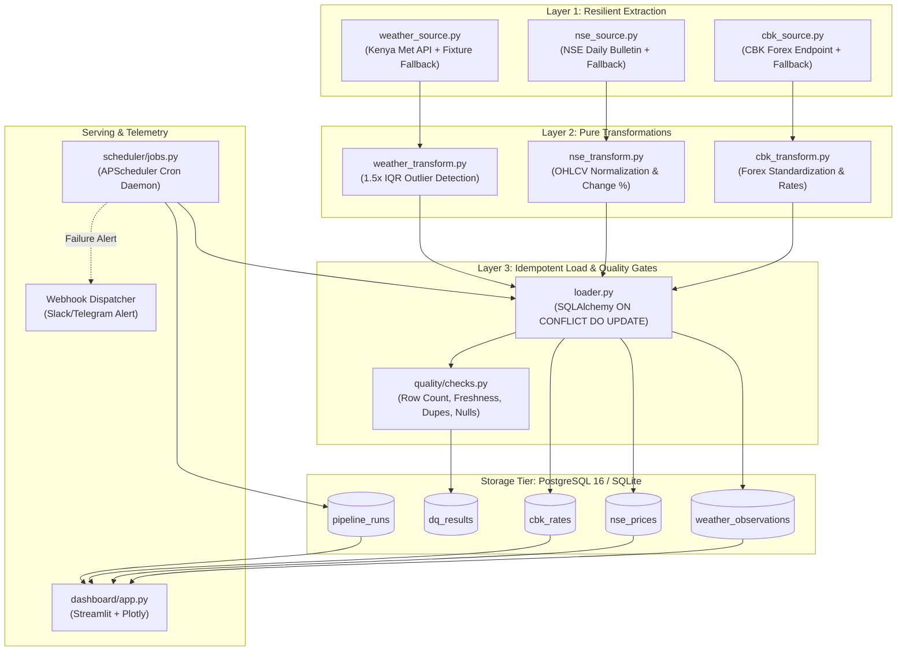

# Architecture & Design

Pulse Pipeline follows modern data engineering best practices with a decoupled **3-Layer Architecture** supported by robust quality gates, audit logging, and dual-dialect storage portability.



---

## 1. Layer 1: Resilient Extraction

Extractors are defined in `etl/extract/`:
* [weather_source.py](https://github.com/crnjihia/pulse-pipeline/blob/main/etl/extract/weather_source.py)
* [nse_source.py](https://github.com/crnjihia/pulse-pipeline/blob/main/etl/extract/nse_source.py)
* [cbk_source.py](https://github.com/crnjihia/pulse-pipeline/blob/main/etl/extract/cbk_source.py)

### Tenacity Retries
Each HTTP extraction function is decorated with `tenacity.retry`:
```python
@retry(
    stop=stop_after_attempt(3),
    wait=wait_exponential(multiplier=1, min=1, max=10),
    retry=retry_if_exception_type(requests.RequestException),
    reraise=True,
)
def _fetch_remote_weather() -> pd.DataFrame:
    ...
```

### Offline Fallback Pattern
If upstream sites are offline, blocked, or experiencing server downtime, the extractor logs a warning and automatically falls back to offline sample fixtures stored in `tests/fixtures/`. Timestamps are synthesized to the current UTC hour so testing and demonstration remain operational anywhere without network latency.

---

## 2. Layer 2: Pure Functional Transformations

Transformers are pure Python functions located in `etl/transform/`:
* [weather_transform.py](https://github.com/crnjihia/pulse-pipeline/blob/main/etl/transform/weather_transform.py)
* [nse_transform.py](https://github.com/crnjihia/pulse-pipeline/blob/main/etl/transform/nse_transform.py)
* [cbk_transform.py](https://github.com/crnjihia/pulse-pipeline/blob/main/etl/transform/cbk_transform.py)

Key properties:
* **No Side Effects**: Input `DataFrame` instances are never mutated; defensive `.copy()` is enforced.
* **Schema Conformance**: Unwanted columns are filtered out and expected schemas strictly enforced.
* **Anomaly Detection**: 1.5x IQR statistical outlier identification for weather data.
* **Missing Value Imputation**: Dash characters (`—`), empty strings, and `N/A` are converted to standard `np.nan`.

---

## 3. Layer 3: Idempotent Upsert & Quality

The loader in `etl/load/loader.py` handles database upserts using dialect-aware SQLAlchemy Core:
```python
if engine.dialect.name == "sqlite":
    from sqlalchemy.dialects.sqlite import insert as sqlite_insert
    stmt = sqlite_insert(table).values(records)
else:
    from sqlalchemy.dialects.postgresql import insert as pg_insert
    stmt = pg_insert(table).values(records)

update_dict = {
    c.name: stmt.excluded[c.name]
    for c in table.c
    if c.name not in conflict_cols and c.name != "id" and c.name in valid_cols
}
stmt = stmt.on_conflict_do_update(index_elements=conflict_cols, set_=update_dict)
```

This guarantees:
1. Re-running the pipeline multiple times does not produce duplicate rows.
2. Revised upstream data updates existing rows seamlessly.
3. High testability: zero external dependencies for local runs or CI.
